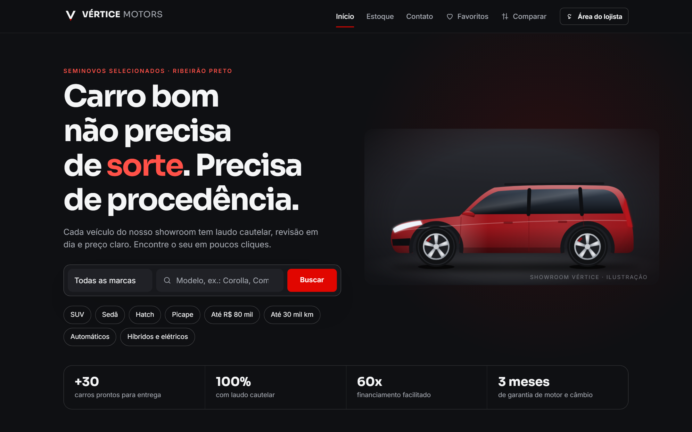
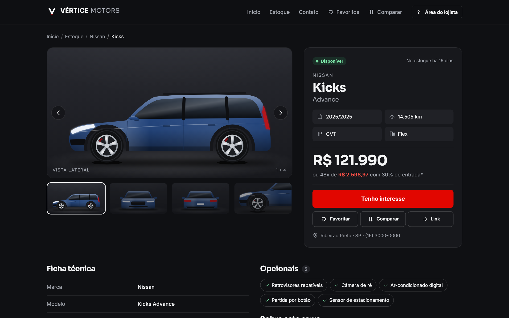
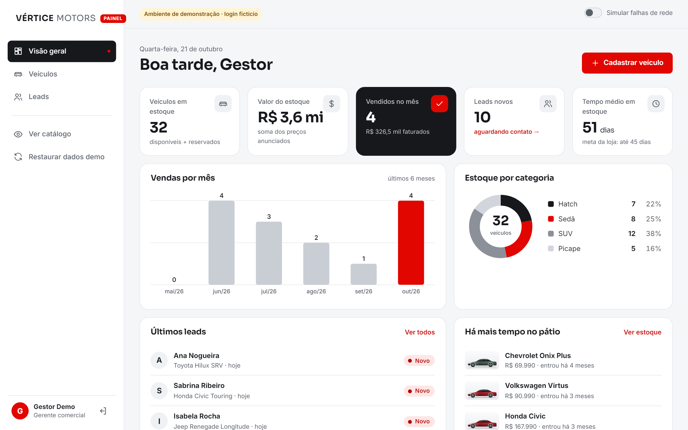

# Vértice Motors: revenda de seminovos em Angular

Aplicação de portfólio que simula o site de uma revenda de carros seminovos, com **catálogo público** (vitrine escura no estilo "showroom") e **painel administrativo** (tema claro) para a equipe da loja. O projeto foi feito para exercitar, em um caso realista, os principais recursos do Angular moderno: componentes standalone, control flow (`@if`/`@for`/`@defer`), signals, Reactive Forms, RxJS, rotas lazy com guards, interceptors e injeção de dependência. Não há back-end: um interceptor HTTP faz o papel do servidor, guarda os dados no `localStorage` e responde com latência simulada (e falhas opcionais, para demonstrar os estados de erro).

> **Tudo é fictício.** A loja "Vértice Motors", os endereços, telefones, preços, placas e pessoas foram inventados. As marcas e modelos citados pertencem aos seus respectivos donos. Nenhuma foto ou logotipo é usado: os carros são **ilustrações SVG** desenhadas pelo próprio componente. O login é uma **demonstração 100% no navegador**, sem autenticação real.

**Demo:** https://ppena23.github.io/revenda-carros-angular/

| Catálogo | Página do veículo | Painel |
| --- | --- | --- |
|  |  |  |

## Acesso ao painel (demonstração)

| E-mail | Senha |
| --- | --- |
| `admin@demo.com` | `demo123` |

As credenciais aparecem na própria tela de login, que tem um botão "Preencher automaticamente".

## Funcionalidades

### Catálogo público (`/`, `/estoque`, `/veiculo/:id`, `/contato`)
- **Home:** hero, busca por marca/modelo, atalhos (SUV, Sedã, Hatch, Picape, até R$ 80 mil, até 30 mil km…), destaques e categorias.
- **Estoque:** filtros de marca, categoria, faixa de preço, ano, km máximo, câmbio, combustível e cor, **sincronizados com a URL** (links compartilháveis, botão "voltar" funciona). Também tem ordenação (relevância, menor/maior preço, mais novo, menor km), contagem de resultados, chips removíveis e paginação. No celular, os filtros abrem em uma gaveta.
- **Página do veículo:** galeria com 4 ângulos (lateral, frente, traseira e detalhe), navegável por teclado; ficha técnica; opcionais em chips; **simulador de financiamento** (Tabela Price, recalculado ao vivo); formulário **"Tenho interesse"**, que cria um lead visível no painel; veículos similares.
- **Favoritos** (persistidos no navegador) e **comparação lado a lado** de até 3 carros, com destaque do melhor valor em cada critério.
- Estados de **carregando** (skeleton), **vazio** e **erro com "Tentar novamente"** em todas as listas.

### Painel administrativo (`/admin`, carregado sob demanda e protegido)
- **Visão geral:** KPIs (estoque, valor do estoque, vendidos no mês, leads novos, tempo médio em estoque), gráfico de vendas por mês, estoque por categoria, últimos leads e carros parados há mais tempo. Os gráficos são SVG feito à mão, com tabela equivalente para leitores de tela.
- **Veículos:** tabela com busca (debounce), filtro por status/categoria, ordenação por coluna (`aria-sort`) e layout em cards no celular. Ações de editar, **marcar como vendido** (modal que registra data e valor da venda) e excluir (com confirmação e atualização otimista).
- **Cadastro/edição:** formulário grande com grupo aninhado, validador entre campos (ano modelo), `FormArray` de opcionais, validador assíncrono de placa única, máscara de placa Mercosul, resumo de erros acessível e **prévia ao vivo** do anúncio. Sair com alterações não salvas abre um diálogo de confirmação.
- **Leads:** funil Novo → Em contato → Proposta → Fechado/Perdido, com busca, mudança de status otimista e taxa de conversão.
- **"Simular falhas de rede":** interruptor que faz metade das leituras da API falhar, para demonstrar os estados de erro. **"Restaurar dados demo"** recria os dados iniciais.

## Conceitos de Angular aplicados → onde no código

| Conceito | Onde |
| --- | --- |
| **Components** (standalone, `input()`/`output()`, content projection) | `shared/components/*` (ex.: `veiculo-card`, `car-illustration`, `estados` com `<ng-content>`), `features/**` |
| **Templates / control flow** (`@if`, `@for` + `track`, `@switch`, `@let`, `@empty`, **`@defer`**) | `car-illustration.html` (`@switch` por ângulo), `estoque.html`, `veiculo-detalhe.html` (`@defer (on viewport; prefetch on idle)` no formulário de lead) |
| **Directives** (atributo, `host`, `Renderer2`, integração com `NgControl`) | `shared/directives/`: `mascara-telefone`, `mascara-placa`, `tooltip` (acessível, `aria-describedby`), `revelar` (IntersectionObserver) |
| **Pipes** customizados | `shared/pipes/`: `moedaBr` (R$ 89.990,00 / compacto), `km` (45.000 km), `tempoEmEstoque` ("há 23 dias"). Também usa `DatePipe`/`DecimalPipe` com `LOCALE_ID` pt-BR |
| **Services + DI** (`inject()`, `providedIn: 'root'`) | `core/services/*` (`VeiculosService`, `LeadsService`, `AuthService`, `FavoritosService`, `ComparadorService`, `NotificacaoService`, `ConfirmacaoService`) |
| **InjectionToken** (com `factory` padrão e override em `useValue`) | `core/config/app.tokens.ts` (`FINANCIAMENTO_CONFIG`, `LOJA_CONFIG`, `API_CONFIG`), sobrescritos em `app.config.ts` |
| **Angular Router** (rotas lazy `loadChildren`/`loadComponent`, `withHashLocation`, `withComponentInputBinding`, `TitleStrategy` customizada, query params) | `app.routes.ts`, `features/catalogo/catalogo.routes.ts`, `features/admin/admin.routes.ts`, `core/config/titulo.strategy.ts`, `estoque.ts` (filtros ↔ URL) |
| **Reactive Forms** (`FormBuilder.nonNullable`, grupo aninhado, **`FormArray`**, `valueChanges`, `statusChanges`) | `admin/veiculos/veiculo-form.ts`, `catalogo/lead-form/lead-form.ts`, `veiculo-detalhe/simulador/simulador.ts`, `estoque.ts`, `admin/login/login.ts` |
| **Validadores customizados** (campo, grupo/cross-field, assíncrono) | `shared/validators/validadores.ts`: `telefoneBrValidator` (formato + DDD), `nomeCompletoValidator`, `placaValidator`, **`anoModeloValidator`** (ano modelo ≥ fabricação e ≤ fabricação + 1), `semDuplicadosValidator` (FormArray), **`placaUnicaValidator`** (assíncrono, consulta a API) |
| **RxJS** (`switchMap`, `debounceTime`, `distinctUntilChanged`, `combineLatest`, `withLatestFrom`, `map`, `filter`, `catchError`, `finalize`, `shareReplay`, `forkJoin`, `startWith`, `timer`) | `estoque.ts` (URL → filtro → API com `switchMap`), `veiculos.service.ts` (`shareReplay`, `forkJoin`), `core/utils/estado-requisicao.ts` (operador customizado `comEstado()`), interceptors (`finalize`, `catchError`) |
| **Observables** (HTTP, `BehaviorSubject` para estado e "recarregar") | `core/data/banco-local.service.ts` (tabelas em `BehaviorSubject` persistidas no localStorage), `recarregar$` nas páginas |
| **Guards** funcionais | `core/guards/auth.guard.ts` (**CanActivate** com `returnUrl` + `visitanteGuard`), `core/guards/alteracoes-pendentes.guard.ts` (**CanDeactivate** com diálogo `<dialog>` nativo) |
| **Interceptors** funcionais | `core/interceptors/`: `auth` (header `Authorization` fake + logout em 401), `logging` (método, status, duração), `fake-backend` (API simulada com latência e falhas) |
| **Signals** (`signal`, `computed`, `effect`, **`linkedSignal`**, `toSignal`/`toObservable`) | `favoritos.service.ts` (signal + effect persistindo), `veiculos-lista.ts`/`leads.ts` (`linkedSignal` para atualização otimista), `veiculo-detalhe.ts` (`toObservable(id)` + `switchMap`) |
| **Standalone / "Modules"** | Não há `NgModule`: `bootstrapApplication` + `app.config.ts` (providers) substituem o `AppModule`, e cada arquivo `*.routes.ts` carregado com `loadChildren` faz o papel de um módulo de feature lazy. Componentes declaram as próprias dependências em `imports` |
| **Organização** | `core/` (singletons: modelos, serviços, guards, interceptors, config), `shared/` (componentes, pipes, diretivas e validadores reutilizáveis), `features/` (catálogo e admin, cada um com suas rotas) |

Também tem: aplicação **zoneless** (padrão do Angular 22) com `OnPush` por padrão; `@defer`; `TitleStrategy` customizada; `<dialog>` nativo para modais; `afterNextRender`.

## Acessibilidade e UX
- Status sempre com **texto + forma/cor** (nunca só cor); foco visível em todos os controles; link "Pular para o conteúdo".
- Formulários com `label`, `aria-invalid`, `aria-describedby`, mensagens em português, foco no primeiro erro e resumo de erros clicável.
- Regiões `aria-live` para contagem de resultados, toasts e simulação; gráficos com tabela alternativa; ilustrações com `role="img"` e texto alternativo.
- `prefers-reduced-motion` desliga animações; layout **mobile-first** sem rolagem horizontal (testado em 390 px).

## Stack
- **Angular 22** (standalone, signals, zoneless) · TypeScript 6 (modo `strict` + `strictTemplates`)
- **RxJS 7** · **SCSS** com variáveis CSS (sem biblioteca de UI)
- Fontes **Sora** + **Inter** (Google Fonts)
- Persistência em `localStorage`/`sessionStorage` via API simulada (interceptor)

## Como rodar

Pré-requisito: Node.js 20.19+ (testado com Node 22).

```bash
npm install
npm start            # ng serve → http://localhost:4200
npm start -- --port 4300   # porta alternativa
npm run build        # build de produção em dist/revenda-carros-angular/browser
```

O build de produção já usa `baseHref` `/revenda-carros-angular/` (configurado em `angular.json`). Para gerar explicitamente: `npm run build:pages`. Como o roteamento usa hash (`/#/estoque`), atualizar a página no GitHub Pages não gera 404.

## Estrutura de pastas

```
src/app/
├── app.config.ts            # providers globais (router, http + interceptors, locale, tokens)
├── app.routes.ts            # rotas raiz → catálogo e admin (lazy)
├── core/
│   ├── config/              # InjectionTokens e TitleStrategy
│   ├── data/                # seed fictício + "banco" em BehaviorSubjects/localStorage
│   ├── guards/              # authGuard, visitanteGuard, alteracoesPendentesGuard
│   ├── interceptors/        # auth, logging, fake-backend
│   ├── models/              # Veiculo, Lead, Dashboard…
│   ├── services/            # Veiculos, Leads, Auth, Favoritos, Comparador, Notificação…
│   └── utils/               # filtros, Tabela Price, datas, operador comEstado()
├── shared/
│   ├── components/          # car-illustration (SVG), veiculo-card, estados, ícones, toasts, diálogo…
│   ├── directives/          # máscaras, tooltip, revelar
│   ├── pipes/               # moedaBr, km, tempoEmEstoque
│   └── validators/          # validadores síncronos, cross-field e assíncrono
└── features/
    ├── catalogo/            # layout escuro, home, estoque, veículo, favoritos, comparar, contato, 404
    └── admin/               # layout claro, login, dashboard, veículos (lista/form/venda), leads
```

---

Feito por **Pedro Pena** · [LinkedIn](https://www.linkedin.com/in/pedropena23/) · [GitHub](https://github.com/PPena23)
